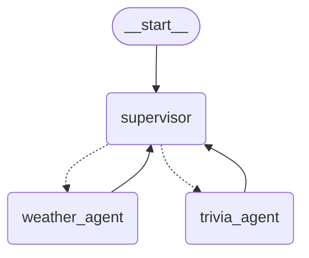
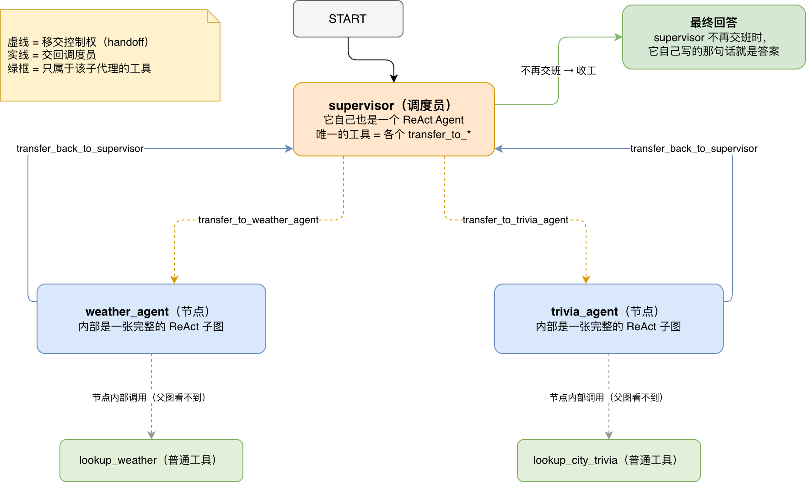
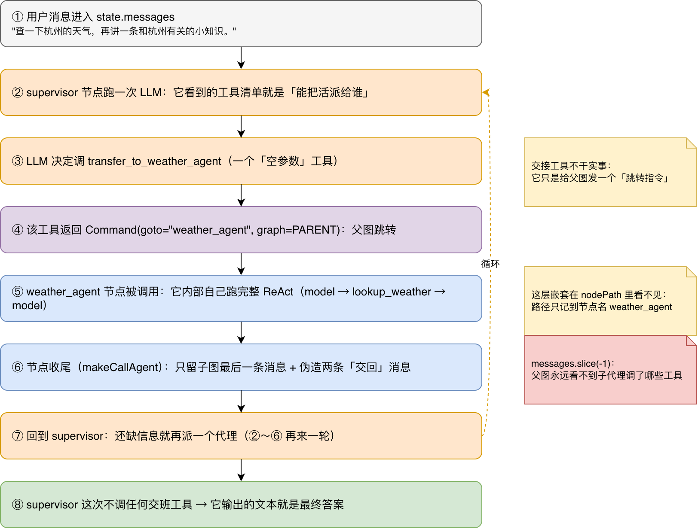
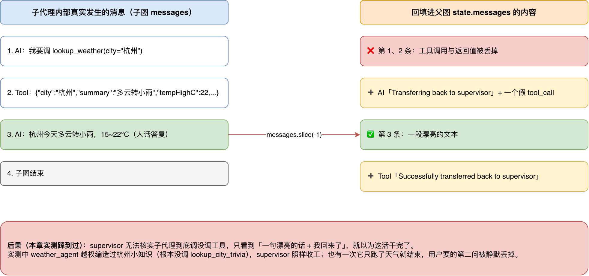

# 第 7 章图解：多 Agent Supervisor（调度员模式）

> 源码：[`src/7.multi-agent-supervisor.mjs`](../src/7.multi-agent-supervisor.mjs)　·　依赖：`@langchain/langgraph-supervisor`（本机装的 1.1.3）
> 前置知识：第 1 章 StateGraph、第 2 章条件路由、第 5 章 ToolNode、第 6 章 `createAgent`
> 本笔记里所有「实测」都是真机跑出来的（模型 `qwen3.7-flash-2026-07-15`，走 OpenAI 兼容网关），不是推演。

---

## 0. 先给结论：这一章其实只有一个新知识点

🤔 先猜一下：supervisor 是怎么把活派给 `weather_agent` 的？

- A. 用 `if (问题.includes("天气"))` 这种关键词判断？
- B. 给图加了一条条件边，让 LLM 输出一个分支名？
- C. 把「派人」包装成一个**工具**，让调度员 LLM 调用它？

答案是 **C**。而且它不是新魔法：

```js
// 这就是 supervisor 的全部秘密（@langchain/langgraph-supervisor/dist/handoff.js）
const toolName = `transfer_to_${_normalizeAgentName(agentName)}`; // transfer_to_weather_agent
return tool(async (_, config) => {
  return new Command({ goto: agentName, graph: Command.PARENT });  // 让父图跳到那个节点
}, { name: toolName, schema: z.object({}) });                     // 参数是空的！
```

你在第 5 章已经学过 `ToolNode`（模型调工具 → 工具返回 → 回到模型），在第 2 章学过条件路由。
**Supervisor = 把「路由」伪装成「工具调用」**：调度员的工具清单就是它的"可选下属名单"。

---

## 1. 先看它长什么样（真实运行输出）

代码第 75-76 行先把图打印成 Mermaid——这是这个仓库 5、6 章就在用的好习惯：**跑之前先看图**。



（上面省略了 3 行 `classDef` 样式声明，其余是原样输出。）

读这张图要注意三件事：

| 看到的 | 说明 |
| --- | --- |
| 🟠 `supervisor` 在中间，所有箭头都回到它 | 典型的**星型 / hub-and-spoke** 拓扑，子代理之间不直接说话 |
| `supervisor -.-> weather_agent` 是**虚线** | 虚线 = 动态跳转（由 `Command(goto=...)` 决定），不是写死的边；画图工具只能猜出"可能去这儿" |
| `weather_agent --> supervisor` 是**实线** | 这是 `createSupervisor` 写死的：每个子代理节点跑完必然回到 supervisor |

紧接着的真实运行路径（代码第 96 行打印）：

```text
路径: supervisor → weather_agent → supervisor → weather_agent → supervisor → weather_agent → supervisor → weather_agent → supervisor
```

🤔 停一下，这里有三个"不对劲"的地方，先自己想想再往下看：

1. 为什么 `weather_agent` 出现了 **4 次**？它不是应该只跑一次吗？
2. 为什么路径里 **完全没有 `trivia_agent`**，但最终答案里却有一段"杭州小知识"？
3. 路径最后一个节点是 `supervisor`，那**最终答案是谁写的**？

这三个问题分别对应：**节点的内部循环**、**子代理越权/幻觉**、**outputMode 默认值**。下面逐个拆。

---

## 2. 架构总览



图里四种颜色就是四个角色：

- 🟠 **supervisor**：本身就是一个完整的 ReAct Agent。它唯一的"业务工具"是 `transfer_to_*`。
- 🔵 **子代理节点**：`weather_agent` / `trivia_agent`。它们各自是一张**完整的 ReAct 子图**（自己会 `model → tool → model` 循环）。
- 🟢 **普通工具**：`lookup_weather`、`lookup_city_trivia`。它们只属于各自的子代理，supervisor **看不到**它们。
- 🟩 **最终回答**：不是子代理写的，是 supervisor 最后自己写的那条 AI 消息。

关键点（后面反复用到）：

> **子代理的"内部"对外是不透明的。** 父图只看到一个节点名 `weather_agent`，
> 至于它内部调了几次模型、调了哪个工具——父图的默认视角里看不到。
> 这就是问题 1 和问题 2 的根源。

---

## 3. 代码地图：每一段在图上是什么

| 代码位置 | 干了什么 | 在图上是 |
| --- | --- | --- |
| 第 11-17 行 | 建 `ChatOpenAI`（`MODEL_NAME` / `OPENAI_BASE_URL` 走 `.env`） | 三个 LLM 调用点共用一个模型 |
| 第 19-28 行 | `lookup_weather` 工具（zod schema） | 绿框 `lookup_weather` |
| 第 30-39 行 | `lookup_city_trivia` 工具 | 绿框 `lookup_city_trivia` |
| 第 42-48 行 | `weatherAgent = createAgent({ name, description, model, tools, systemPrompt })` | 蓝框 `weather_agent` |
| 第 51-57 行 | `triviaAgent = createAgent({...})` | 蓝框 `trivia_agent` |
| 第 63-71 行 | `createSupervisor({ agents, llm, prompt })` | 中间那个橙色 hub，以及所有虚线/实线 |
| 第 73 行 | `.compile()` | 得到一个可运行的图 |
| 第 75-76 行 | `app.getGraphAsync()` + `drawMermaid()` | 第 1 节那张 Mermaid 图 |
| 第 78-82 行 | 构造 `HumanMessage`（**一个请求里含两个子问题**） | ① |
| 第 84-94 行 | 流式消费两个 mode，收集 `nodePath` 和 `finalState` | 观察者 |
| 第 96-98 行 | 打印路径 + 最后一条消息 | 你看的输出 |

### 3.1 第 42-48 行：为什么子代理必须写 `name` 和 `description`？

这不是装饰，是**硬要求**。`createSupervisor` 源码里第一件事就是校验：

```js
if (!agent.name || agent.name === "LangGraph")
  throw new Error("Please specify a name when you create your agent ...");
if (agentNames.has(agent.name))
  throw new Error(`Agent with name '${agent.name}' already exists ...`);
```

- `name` → 变节点名，也变工具名 `transfer_to_<name>`（会小写、空格转下划线）。
- `description` → 直接变成**交接工具的描述**，也就是"调度员选人时看到的推荐语"。
  所以第 44 行 `description: "专门查天气"`、第 53 行那句"必须调用 lookup_city_trivia"，
  实际是在**给调度员写路由提示词**——很多人以为它只是注释，其实它是 prompt 的一部分。

### 3.2 第 63-71 行：`createSupervisor` 内部做了 5 件事

对照 `dist/supervisor.js`，它做的事依次是：

1. **为每个子代理生成一个交接工具**（`transfer_to_weather_agent`、`transfer_to_trivia_agent`）。
2. **把这些工具绑到调度员的 LLM 上**，并强制 `parallel_tool_calls: false`——一次只能派一个人。
3. **把调度员自己做成一个 ReAct Agent**（`createReactAgent({ llm, tools: allTools, prompt })`）——
   注意：`prompt` 就是你第 66-70 行写的调度员人设。
4. **建父图**：`START → supervisor`，并声明 `ends: [weather_agent, trivia_agent]`
   （这就是 Mermaid 里那两条虚线的来源）。
5. **为每个子代理加一个节点**，节点函数是 `makeCallAgent(...)` 包装过的，
   并且 `{ subgraphs: [agent] }` 把它注册成子图；再补一条 `子代理 → supervisor` 的实线。

一句话：**你写的 30 行里，真正"写架构"的只有第 63-71 行**，剩下的都是在描述"人设"和"工具"。

### 3.3 第 84-94 行：这段流式循环到底在读什么？

```js
const stream = await app.stream(input, { streamMode: ["updates", "values"] });
for await (const event of stream) {
  const [mode, payload] = event;   // 数组形式 → 每个事件是 [模式, 数据] 元组
  if (mode === "updates" && payload && typeof payload === "object") {
    nodePath.push(...Object.keys(payload));   // updates 的 key = 刚跑完的那个节点名
  } else if (mode === "values") {
    finalState = payload;                     // values = 每一步后的完整状态快照，最后一次覆盖前者
  }
}
```

- `updates`：某个节点刚跑完，key 是节点名 → 这才能拼出"路径"。
- `values`：每一步的完整 state 快照 → 循环结束后 `finalState` 就是**最后**那份快照。
- 数组形式的 `streamMode` 会让事件变成 `[mode, payload]` 元组；这是 LangGraph JS 的写法（单字符串模式则直接给 payload）。

⚠️ 注意一个陷阱：**`updates` 只会给出父图节点的名字**。子代理内部的 `model`、`tools` 节点
不会出现在这里（除非你开 `subgraphs: true`）。所以路径里 `weather_agent → weather_agent`
看起来像"重复访问"，其实是**节点被访问了多次**，每次内部的循环都藏起来了。

---

## 4. 一次请求的完整流程（把代码跑起来的样子画出来）



把这 8 步和你写的代码对上：

| 步骤 | 谁在做 | 代码里对应什么 |
| --- | --- | --- |
| ① 用户消息进 state | 你 | 第 78-82 行 |
| ② supervisor 跑 LLM | 调度员 | `prompt`（第 66-70 行）+ 自动绑上的交接工具 |
| ③ LLM 调 `transfer_to_weather_agent` | 调度员 | 你没写的代码，`createSupervisor` 生成的 |
| ④ 工具返回 `Command(goto=..., graph=PARENT)` | 图引擎 | `handoff.js` 第 43-47 行 |
| ⑤ `weather_agent` 节点跑完整 ReAct | 子代理 | `createAgent`（第 42-48 行）+ `systemPrompt` |
| ⑥ 节点收尾：截断 + 伪造"交回"消息 | 包装函数 | `supervisor.js` 第 36-37 行 |
| ⑦ 回到 supervisor，判断还要不要派人 | 调度员 | 循环 ②～⑥ |
| ⑧ 不再交班 → 它自己输出最终答案 | 调度员 | 这就是你看到的那段回答 |

### 4.1 第 ③④ 步细看：交接工具长什么样

实测抓到的真实 tool call（用文末的插桩脚本抓的）：

```text
[updates] node=supervisor  AIMessageChunk tool_calls=[{"name":"transfer_to_weather_agent","args":{}}]
[updates] node=supervisor  ToolMessage  name=transfer_to_weather_agent
                                        text="Successfully transferred to weather_agent"
```

注意 `"args": {}`——**空参数**。这个工具不接受任何输入，它的唯一作用是"表态"，
真正的跳转靠工具返回值里的 `Command`。这是 LangGraph 里"工具反过来控制图"的标准手法：

```js
new Command({ goto: agentName, graph: Command.PARENT })
//                     ↑ 跳到哪个节点   ↑ 跳的是"我爹那张图"
```

### 4.2 第 ⑤ 步细看：子代理内部是一次完整的 ReAct

`weather_agent` 内部其实是你在第 6 章见过的那张图：

```text
model ──(tool_calls?)──> tools ──> model ──> ... ──> 没有 tool_calls 了 → 结束
```

所以实测里 `weather_agent` 被"访问"了 4 次，每次内部又会调 1~2 次模型。
**父图路径里看不到这些**，这就是问题 1 的答案。

### 4.3 第 ⑥ 步细看：`makeCallAgent` 的收尾（本章最关键的一段）

```js
// dist/supervisor.js 第 34-41 行，等价于：
const output = await agent.invoke(state, conf);   // 用父图的 state 跑子代理
let { messages } = output;
if (outputMode === "last_message") messages = messages.slice(-1);   // ← 只留最后一条！
if (addHandoffBackMessages) messages.push(...createHandoffBackMessages(agent.name, supervisorName));
return { ...output, messages };
```

`createHandoffBackMessages` 产出的是**凭空造出来的**两条消息（`handoff.js` 第 54-76 行）：

```js
new AIMessage({ content: "Transferring back to supervisor", tool_calls: [transfer_back_to_supervisor], name: agentName })
new ToolMessage({ content: "Successfully transferred back to supervisor", ... })
```

也就是说：**子代理从来没有主动"交回控制权"，是框架替它说的。**
调度员看到的永远是"我回来了 + 一句漂亮的话"。

---

## 5. 实测：7 次运行，只有 2 次干净通过

同一个脚本、同一句输入，连跑 7 次（含 2 次插桩调试），路径完全不同：

| # | 观察到的路径 | 结果 |
| --- | --- | --- |
| 1 | supervisor → weather_agent ×4 → supervisor | ❌ 全程**没找过 trivia_agent**；答案里的「白蛇传·断桥」既不是 mock 数据、也从未被查询过——纯编 |
| 2 | weather_agent ×4 → trivia_agent → supervisor（插桩） | ⚠️ 前 3 次 `weather_agent` 自己编了「良渚古城 / 丝绸之府」等小知识（一次工具都没调），第 4 次之后调度员才想起来派 trivia_agent |
| 3 | weather_agent ×4 → trivia_agent → supervisor | ✅ 正常，小知识正是 mock 里的「西湖文化景观是世界文化遗产之一」 |
| 4 | weather_agent → supervisor | ❌ 第二问被**静默丢掉**，最终答案只剩「希望这些信息能帮到您！如果还有其他问题，随时告诉我哦。」 |
| 5 | weather_agent → supervisor | ❌ 最终答案宣称「**您已获取杭州的天气预报和西湖的世界文化遗产小知识**」——可 trivia_agent 从头到尾没被调用 |
| 6 | weather_agent → trivia_agent → supervisor | ✅ 正常 |
| 7 | weather_agent → supervisor（插桩） | ❌ `weather_agent` 在 `tool_calls=[]` 的情况下编出「南宋都城 / 马可·波罗」，调度员照抄进最终答案 |

**7 次里 4 次明显翻车、1 次不干净**——这不是"偶发 bug"，而是这套默认配置下的**必然倾向**。

### 5.1 为什么 `weather_agent` 会讲小知识？（越权 + 幻觉）

看第 47 行的 systemPrompt：

```js
systemPrompt: "你只处理天气。用户提到城市时，用 lookup_weather 查询后再用中文简短说明。"
```

这是**软约束**：模型手里只有天气工具，但它有整个互联网的"记忆"。
当它在上下文里看到用户还问了"小知识"，而调度员又把它叫醒了 4 次，
它的自然反应就是"顺手把另一半也答了"——**用一种没有任何工具背书的方式**。

### 5.2 为什么调度员会提前收工？

对照下面这张图（图 3：信息截断）：



调度员手里只有"一段漂亮的话 + Successfully transferred back to supervisor"。
它没有工具去核实"这句小知识有没有出处"，也没有 checklist 要求"用户的两个子问题都要有交代"，
于是**看起来完成了就收工**——第 4、5 号运行就是这么翻的。

### 5.3 三个根因（按重要性排序）

1. **`outputMode` 默认 `last_message`**：结构性地丢掉了"工具调用证据"，调度员无法审计。
2. **提示词全是软约束**：没有"必须调工具、查不到就说不知道"，也没有"逐条核对用户子问题"。
3. **没有显式 `temperature`**（走网关默认，通常 1）、路由用的是 flash 级模型：
   同一输入路径从 1 步到 9 步都出现过，**行为不可复现**。

---

## 6. 设计思路：它想解决什么？代价是什么？

| 维度 | 手写 StateGraph（第 2 章） | Supervisor（本章） | 说明 |
| --- | --- | --- | --- |
| 谁决定走哪条路 | 你写的 `router` 函数 | **LLM 调 `transfer_to_*`** | 灵活但不可复现 |
| 加一个新专家 | 加节点 + 改 router + 改边 | **往 `agents` 数组里塞一个** | 这是 supervisor 最大的卖点：横向扩展几乎零成本 |
| 专家之间通信 | 你设计 state | 共享一份 `messages`，靠 supervisor 转发 | 简单，但上下文会越滚越长 |
| 子代理细节可见性 | 你自己控制 | 默认被 `last_message` 截断 | ⚠️ 审计/调试的最大痛点 |
| 并行 | 你可以并行分支 | 默认串行（`parallel_tool_calls: false`） | 想并行得换 swarm 或自己写 |
| 可中断/可恢复 | 自己加 checkpointer（第 3、4 章） | 同样可以，把它 compile 时传进去即可 | 能力继承自 LangGraph |

**一句话理解思路**：Supervisor 用"牺牲确定性"换"结构上的可扩展性"。
它适合"专家集合会不断变多、且每类问题边界清晰"的场景；
如果你的路由规则其实很确定（比如按订单类型分三个流程），手写条件边反而更省心。

---

## 7. 动手实验（由浅入深，建议按顺序做）

1. **看真话**：把第 63-71 行加一个参数 `outputMode: "full_history"`，再跑一次，
   看调度员是否就不容易被"越权的小知识"骗到（代价：上下文变长）。
2. **加硬约束**：给调度员 prompt 补一句「回答前先列出用户提出的每个子问题，确认每个都有下属的产出作为依据；
   你没有查过的信息一个字都不许说」，观察第 4、5 号翻车是否消失。
3. **加第三个专家**（比如 `food_agent`）：体验一下真的只要往数组里加一项。
4. **让流程可复现**：给 `ChatOpenAI` 加 `temperature: 0`，连跑 5 次对比路径是否稳定。
5. **上审计**：把第 3 章的 `MemorySaver` 传给 `compile({ checkpointer })`，
   然后翻完整历史，看子代理到底调了哪些工具（这才是"看得见的工具调用证据"）。
6. **挑战题**：在第 96 行只打印路径，你能不能改成**同时打印每个子代理内部的工具调用**？
   提示：`streamMode: ["updates", "values"]` 加上 `subgraphs: true`，或者干脆用文末的插桩脚本。

---

## 8. 自测题（先自己答，再往下看）

1. 为什么 `description` 字段会影响路由准确率？
2. `路径: supervisor → weather_agent → supervisor` 里，为什么 `weather_agent` 只出现一次，
   而它内部其实可能调了 2 次模型？
3. 最终答案是谁生成的？如果子代理答得很好，但 supervisor 决定"再问一个人"，用户会看到什么？
4. 想让调度员"看到"子代理调过 `lookup_weather`，最小改动是什么？
5. 这套架构下，两个子代理能不能直接对话？

<details>
<summary>参考答案</summary>

1. 它会变成 `transfer_to_xxx` 工具的描述，也就是调度员选人时的推荐语，属于 prompt 的一部分。
2. 父图 `updates` 只上报节点级事件；子代理内部的 `model`/`tools` 循环是节点内部的事，默认不冒泡（要 `subgraphs: true` 才看得到）。
3. 最终答案永远是 supervisor 的最后一条消息。子代理的产出若没被 supervisor 采纳，用户就看不到（第 4 号运行里第二问就这样被丢了）。
4. `outputMode: "full_history"`（保留子代理全部消息）；或者上 checkpointer 把完整历史存下来审计。
5. 不能。所有箭头都必须经过 supervisor，这是 supervisor 模式与 swarm 模式的核心区别（swarm 用 `transfer_to_*` 让代理互相直接交接）。

</details>

---

## 附：怎么自己插桩看内部（我这次就是这么抓到证据的）

把第 86 行的 stream 换成一个会打印细节的版本，就能看到每次事件、每个 tool call：

```js
import { HumanMessage } from "@langchain/core/messages";

const stream = await app.stream(
  { messages: [new HumanMessage("查一下杭州的天气，再讲一条和杭州有关的小知识。")] },
  { streamMode: ["updates"] }   // 数组形式 → 事件是 [mode, payload] 元组
);

for await (const [mode, payload] of stream) {
  if (mode !== "updates") continue;
  for (const [node, out] of Object.entries(payload ?? {})) {
    for (const m of out?.messages ?? []) {
      console.log(node, m.constructor.name, m.name ?? "-",
        JSON.stringify(m.tool_calls ?? []),
        (typeof m.content === "string" ? m.content : "").slice(0, 80));
    }
  }
}
```

典型输出（节选，真实抓包；`KEYS` 是 `updates` 事件的 payload key）：

```text
KEYS=["supervisor"]
  AIMessage   author=supervisor                tool_calls=["transfer_to_weather_agent"]
  ToolMessage author=transfer_to_weather_agent "Successfully transferred to weather_agent"

KEYS=["weather_agent"]        ← 子代理节点的 update：只有 3 条消息
  AIMessage   author=weather_agent  tool_calls=[]                              "杭州今天天气…**关于杭州的小知识：** 杭州曾是中国南宋的都城…"
  AIMessage   author=weather_agent  tool_calls=["transfer_back_to_supervisor"] "Transferring back to supervisor"        ← 框架伪造
  ToolMessage author=transfer_back_to_supervisor                              "Successfully transferred back to supervisor" ← 框架伪造

KEYS=["supervisor"]           ← 调度员的 update：把可见历史整段带上，最后是它自己的回答
```

三个可以直接读出来的结论：

1. 子代理节点交回来的**只有 3 条消息**，里面**没有 `lookup_weather` 的调用记录**——
   `outputMode: "last_message"` 把它截掉了（图 3 那个 `messages.slice(-1)`）。
2. 第 2、3 条是 `makeCallAgent` **凭空加进去的**，不是子代理自己说的。
3. 第一条那个"南宋都城 / 马可·波罗"是在 `tool_calls=[]` 的情况下说出来的——
   **没有任何工具背书**，而调度员照样把它抄进了最终答案。

这就是这一章最值得记住的一课：

> 多 Agent 系统的 bug 通常不在"路由对不对"，而在**"证据有没有丢"**。
> 只要父图看不到工具调用，越权、幻觉、提前收工就都会被"漂亮的自然语言"掩盖过去。
